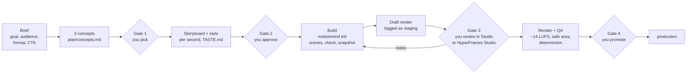

<div align="center">


# MotionMind

**Make videos with your AI coding agent. MotionMind tracks, measures and shows every version.**<br>
Promos, reels, product demos and tutorials built as HyperFrames projects by the agent you already use, with a local
studio that works like MLflow for renders.

[](https://www.npmjs.com/package/motionmind)
[](https://github.com/Motion-Minds/motionmind-video/blob/main/LICENSE)
[](#how-the-skill-keeps-quality-up)
[](https://github.com/heygen-com/hyperframes)
[](#install)


<sub>30-second walkthrough · <a href="https://github.com/Motion-Minds/motionmind-video/blob/main/docs/gallery/walkthrough.mp4">MP4 with sound (0.8 MB)</a> · made with MotionMind itself</sub>

[What you get](#what-you-get) · [Quick start](#quick-start) · [Workflow](#workflow) · [Example prompts](#example-prompts) · [Studio](#the-studio) · [Install](#install) · [FAQ](#faq)

</div>

---

## Why

AI agents can already write a motion graphic. What goes wrong is everything around it: the agent skips straight to
code, every "small change" overwrites the version the client approved, nobody knows which render was the good one,
the audio is at a random level, and the next chat starts from zero.

MotionMind gives the agent a **production process** and gives you a **record of it**:

- a bundled agent skill that makes the agent work like a studio — concepts first, storyboard second, build, review,
  render, with you approving each gate;
- a CLI that turns every render into a frozen, measured **version** (video, contact sheet, source snapshot, loudness,
  parameters, checksum);
- a local **Studio** where you watch, compare side by side, edit in HyperFrames Studio without code, and promote a
  version to production.

## What you get

| | Part | What it does |
|---|---|---|
| 🧠 | **`motionmind` skill** | Four-gate workflow, HyperFrames rules, motion and sound guidance, QA checklist, screen-demo kit. Works with any agent that reads `SKILL.md`. |
| ⌨️ | **`motionmind` CLI** | `setup`, `init`, `render`, `log`, `promote`, `track`, `compare`, `music`, `sfx`, `doctor`. The agent calls it; you can too. |
| 🖥️ | **Studio** (`motionmind ui`) | Dashboard at `127.0.0.1:4310`: every version with player, 4:5 safe-area overlay, contact sheet, LUFS, parameters, stages, compare, docs. |
| 🎵 | **Music bed** | `motionmind music`: deterministic, sample-free 120 BPM beds with sections (tense, calm, groove, lift, outro), bells and ducking. |
| 🔊 | **Starter SFX** | 22 CC0 sounds (clicks, pops, chimes, whooshes, risers, impacts) built in; plug in your own library any time. |
| 📡 | **Tracking** | Already working in HyperFrames Studio or another editor? `motionmind track` logs every render or export as a version. |

### What you can make

| | Output | Typical length |
|---|---|---|
| 🎬 **Promos & reels** | launches, app promos, campaign spots, 9:16 social | 6–30 s |
| 🖥️ **Product demos** | real product screenshots with a moving camera, cursor and highlights | 20–60 s |
| 🧭 **Tutorials & explainers** | chaptered walkthroughs, step-by-step how-tos, 16:9 or 9:16 | 30–90 s |
| 🔤 **Kinetic typography** | statements, announcements, hooks | 5–20 s |
| 📺 **Bumpers & end cards** | logo moments, CTAs, idents | 3–10 s |

Every version is a HyperFrames project (HTML + GSAP) rendered to MP4, so it can be reopened, edited visually in
HyperFrames Studio, and re-rendered identically later.


<sub>A 6-second 9:16 demo for the fictional <i>Demo Coffee</i> brand that ships in <code>shared/brands/demo/</code>:
built with <code>motionmind init</code>, music from <code>motionmind music</code>, three sounds from the starter pack,
rendered at −13.7 LUFS.</sub>

## Quick start

Requirements: Node.js 22+, `ffmpeg`/`ffprobe` on `PATH`, and an AI coding agent CLI. HyperFrames and its headless
Chrome are fetched on first use.

```bash
npm i -g motionmind
motionmind setup my-studio        # workspace + motionmind skill + official HyperFrames skills
cd my-studio
motionmind doctor                 # Node, ffmpeg, Chrome, HyperFrames, skill, agent CLI
motionmind ui                     # Studio at http://127.0.0.1:4310 — keep it running
```

In a second terminal, in the same folder:

```text
$ claude            # or codex, gemini, opencode …
> Use the motionmind skill. I want a 15-second 9:16 promo for my coffee shop "Kopi Senja",
  message "great coffee, friendly prices", CTA kopisenja.id, music + SFX, no voice-over.
```

Expect a few rounds of conversation, not a one-shot: the agent stops at each gate and waits for you.

## Workflow



1. **Brief the agent.** Product, audience, format and length, audio (music only, voice-over coming, temporary TTS),
   CTA, what must be on screen. Put the logo, fonts and product screenshots in `shared/brands/<brand>/`.
2. **Pick a concept.** Two or three genuinely different stories in words, written to `plan/concepts.md`.
3. **Approve the storyboard.** A per-second table, and the style locked in `TASTE.md` (palette with roles, type,
   easing, music) so later versions look and move the same.
4. **Let it build.** `motionmind init` creates the version folder; the agent writes one scene per file, runs
   HyperFrames `check` and `snapshot` after every change, and looks at the frames.
5. **Review.** Watch the draft in the Studio, or press **Edit di HyperFrames** to change text, timing or audio without
   code. While you edit, the version is locked for the agent.
6. **Promote.** After QA (−14 LUFS, true peak ≤ −1 dBFS, 9:16 safe area, CTA held), you move it to production; the
   previous production version of the same aspect ratio is archived, never deleted.

> **Tip:** a new message or audience is a new **campaign**; a new hook, style, music or ratio for the same message is a
> new **version** (`v2-…`) in the same campaign. Rendered versions are never overwritten.

## Example prompts

```text
Use the motionmind skill. A 30-second 9:16 promo for our note-taking app. Logo and screenshots are in shared/brands/notely/.
```
```text
Use the motionmind skill. A 45-second 16:9 product tour of our HR dashboard from the captures in shared/brands/acme/captures/,
camera following the clicks, music + SFX.
```
```text
Use the motionmind skill. Kinetic typography for our festival: "City of Sound, 3 nights, 48 stages". Loud, 9:16, 12 seconds.
```
```text
Continue acme/launch-15s: make v2 with a new hook that starts from the problem; keep the style from TASTE.md.
```
```text
Revise acme/launch-15s v2: the CTA is too small and the second scene is rushed. Render again when fixed.
```

**Getting better results**

- Give real brand material: logo files, fonts, palette, product screenshots at 2× resolution.
- Say the format, the length and the one thing the viewer must remember. Short text wins.
- References are for rhythm and technique, never for copying layouts, colours or assets.
- Start a new chat per new video; resume an old one by naming its campaign — the agent reads `TASTE.md`,
  `PROGRESS.md` and `LOG.md` first.

## The Studio

`motionmind ui` serves a local dashboard over the workspace (it only binds to `127.0.0.1`).

<table>
<tr>
<td width="50%"><br><b>All runs</b><br><sub>Every version with stage, resolution, loudness and engine, filtered by campaign or stage.</sub></td>
<td width="50%"><br><b>Compare</b><br><sub>Two versions played in sync, with a table of what changed: parameters, loudness, size.</sub></td>
</tr>
<tr>
<td><br><b>Run page</b><br><sub>Player with 4:5 safe-area overlay, contact sheet, breakdown, parameters, stage, Edit in HyperFrames, Render.</sub></td>
<td><br><b>Docs</b><br><sub>The skill and its references, readable by you exactly as the agent reads them. Plus a Starter kit that turns a brief into a prompt.</sub></td>
</tr>
</table>

### MotionMind, the MLflow way

| MLflow | MotionMind |
|---|---|
| tracking store (`mlruns/`) | workspace with `motionmind.store.json` (or `~/.motionmind`, or `$MOTIONMIND_STORE`) |
| experiment | campaign `<brand>/<campaign>` |
| run · params · metrics · artifacts | version `v<N>-<slug>` · composition, variables, CLI version · LUFS, true peak, duration, render time · `video.mp4`, contact sheet, `src/` snapshot |
| `mlflow.autolog()` | `motionmind track` + `motionmind ui` / `watch`: every render in a tracked project is logged |
| `mlflow.log_*` | `motionmind log <video> --param k=v --metric k=n` |
| model registry stages | `staging` → `production` → `archived`, one production version per aspect ratio |
| `mlflow ui` | `motionmind ui` |

### Already working in HyperFrames Studio or another editor?

Let MotionMind just keep the record — every render or export becomes a version:

```bash
motionmind track ~/Movies/HyperFrames/my-video --campaign acme/launch-15s   # HyperFrames: watches renders/
motionmind track ~/Exports/premiere --campaign acme/launch-15s-cut          # any editor: watches new .mp4 files
motionmind log ./final.mp4 --campaign acme/launch-15s --param hook="Stock running low?"
motionmind compare acme-launch-15s-v1 acme-launch-15s-v2
motionmind promote acme-launch-15s-v2 --stage production
```

## Install

### npm (recommended)

```bash
npm i -g motionmind        # or run any command with npx motionmind …
motionmind setup my-studio
```

`setup` creates the workspace (`motionmind.store.json`, `projects/`, `shared/brands/`, `AGENTS.md`, `CLAUDE.md`),
copies the skill to `.agents/skills/motionmind` with a link at `.claude/skills/motionmind`, and runs
`npx hyperframes skills` to install the official HyperFrames skills into your agents' global skill folders (in your
home directory; skip with `--no-hyperframes-skill`). Update the motionmind skill later with `motionmind skill install`
(add `--global` to install it into `~/.agents` and `~/.claude` instead).

### From source

```bash
git clone https://github.com/Motion-Minds/motionmind-video.git && cd motionmind-video/studio
npm install && npm run build && npm link     # provides the motionmind command
```

### The skill only

The skill is a plain Agent Skills folder: `studio/skills/motionmind/` (`SKILL.md`, `references/`, `assets/`). It still
needs the `motionmind` CLI on `PATH` for its commands.

| Agent | Where it goes |
|---|---|
| Claude Code | `.claude/skills/motionmind` in the project, or `~/.claude/skills/motionmind` |
| Codex CLI · OpenCode · omp | `.agents/skills/motionmind` or `~/.agents/skills/motionmind`, or reference it from `AGENTS.md` |
| Gemini CLI · Cursor · others | copy into the project and reference `SKILL.md` from `GEMINI.md`, `.cursor/rules`, or the system prompt |

> Install **one copy** per scope. `motionmind skill install` refuses to overwrite a folder it did not create unless
> you pass `--force`.

## Requirements

| To… | You need |
|---|---|
| Run the CLI and Studio | Node.js 22+ |
| Render, measure loudness, make contact sheets | `ffmpeg` + `ffprobe` on `PATH` |
| Render HyperFrames | nothing extra — `npx` fetches the pinned HyperFrames CLI and its headless Chrome |
| Make videos with an agent | an agent CLI that reads skills: Claude Code, Codex, Gemini CLI, OpenCode, … |
| Your own sound library | optional — a folder with one sub-folder per category, `MOTIONMIND_SFX=<folder>` |
| Nicer Studio fonts | optional — Satoshi and Geist files in `shared/ui-fonts/` (system fonts otherwise) |

`motionmind doctor` checks all of this and says what is missing.

## Commands

| Command | What it does |
|---|---|
| `motionmind setup [dir]` · `doctor` · `skill install [--global]` | create a workspace, check prerequisites, install/update the skill |
| `motionmind ui [--port] [--no-watch]` | Studio + autolog for tracked projects |
| `motionmind init b/c v1-slug --engine hyperframes [--resolution portrait\|landscape\|square]` | new version folder with a pinned HyperFrames project and brand assets |
| `motionmind import <dir> b/c v1-slug` | copy an existing HyperFrames project into a new version |
| `motionmind edit b/c [version] [--stop]` | open HyperFrames Studio on a version (or the tracked project); locks it for agents |
| `motionmind render b/c [version]` | render with the pinned CLI, make the contact sheet, measure, update the record |
| `motionmind log <video> --campaign b/c [--param k=v] [--metric k=n] [--stage]` | record any video as a version |
| `motionmind track <dir> --campaign b/c [--backfill]` · `untrack` · `tracked` · `watch [--once]` | autolog renders of a project you edit elsewhere |
| `motionmind promote <run_id> --stage production\|staging\|archived` · `list` · `compare <a> <b>` | registry operations |
| `motionmind music --out x.wav --duration 15 --sections 0:tense,2:groove,5:outro` | deterministic music bed |
| `motionmind sfx list [--query]` · `sfx scan` | SFX catalogue (built-in CC0 pack, or your library) |

## How the skill keeps quality up

- **Gates before code** — concepts, then storyboard and style; nothing is built before you choose.
- **One version, one folder** — new direction means `v<N+1>`; approved renders are frozen with their source, assets
  and pinned CLI, so they re-render identically.
- **Look at the output** — HyperFrames `check` and `snapshot` after every change; the agent opens the frames and the
  contact sheet before saying "done".
- **Style memory** — palette with colour roles, type, easing and music live in `TASTE.md`; feedback becomes rules there.
- **Determinism** — no randomness or clocks in scenes; the same render twice gives identical frames.
- **Sound that's measured** — −14 LUFS integrated, true peak ≤ −1 dBFS, read from the rendered file every time.
- **Phone-safe layout** — 9:16 text and CTA inside y 285–1635, body text ≥ 28 px, CTA held still at the end.
- **Edit lock** — while you edit in HyperFrames Studio, the agent does not touch the project; afterwards it reads
  your changes first.
- **Rights** — only assets the user owns or can license; every sound and download has its source recorded.

Full detail: `studio/skills/motionmind/SKILL.md` and `references/` (workflow, HyperFrames, motion, sound, QA, screen demo).

## Repository layout

```
studio/                          the npm package "motionmind"
  skills/motionmind/             the agent skill: SKILL.md, references/, assets/screen-kit.js
  core/                          store, runs, HyperFrames adapter, media, music, SFX, setup
  cli/                           the motionmind command
  app/ components/ lib/          the Studio (Next.js)
  sfx/                           CC0 starter sound pack + catalog.json
  starter-kits/ templates/       prompt kits and campaign templates
  public/brand/                  MotionMind logo
shared/brands/demo/              example brand kit (palette, colour roles, logo)
shared/brands/motionmind/        MotionMind brand kit
AGENTS.md                        instructions for agents working in this repo / store
scripts/                         export_oss.py, brand-capture notes
docs/gallery/                    README images
```

## FAQ

<details>
<summary><b>Does MotionMind generate the video by itself?</b></summary>

No. Your AI agent writes the video, following the `motionmind` skill; MotionMind provides the process, the commands,
the record and the Studio. That is also why it works with whichever agent and model you prefer.
</details>

<details>
<summary><b>Is the output a video file?</b></summary>

Yes, an H.264 `video.mp4` per version, next to its contact sheet and the HyperFrames source that produced it.
</details>

<details>
<summary><b>Can I change a video without code?</b></summary>

Yes. Press **Edit di HyperFrames** on a version (or run `motionmind edit`) to open HyperFrames Studio: timeline, text
variables, audio clips. Then render again from the Studio.
</details>

<details>
<summary><b>I already made videos in HyperFrames Studio, Premiere or CapCut. Can I still use it?</b></summary>

Yes. `motionmind track <folder> --campaign <brand>/<campaign>` records every new render or export; `motionmind log`
records a single file.
</details>

<details>
<summary><b>Are the sounds and music safe for client work?</b></summary>

The built-in pack is CC0 (Kenney's Interface Sounds plus sounds synthesised for MotionMind) and the music bed is
generated from code. Sounds you add are yours to license; `motionmind sfx list --unlicensed` shows what has no
licence recorded.
</details>

<details>
<summary><b>Does anything leave my machine?</b></summary>

The Studio binds to `127.0.0.1` and reads local files. HyperFrames is run with telemetry off. Your agent talks to its
own model provider as usual.
</details>

<details>
<summary><b>Can I use other skills?</b></summary>

Yes. Skills in `~/.agents/skills/` or `.agents/skills/` (Remotion, the official HyperFrames skills, your own brand skills)
sit next to `motionmind`; the agent picks whichever fits the request.
</details>

## Contributing

Issues and pull requests are welcome. Behaviour lives in `studio/core/` (the CLI and Studio share it); a rule for the
agent goes in `studio/skills/motionmind/`, with the failure it prevents. Run `npm run typecheck` and `npm run build` in
`studio/`, and bump `version` in `studio/package.json`.

## License

[MIT](https://github.com/Motion-Minds/motionmind-video/blob/main/LICENSE) © 2026 Vinzzztty. The MotionMind name and logo identify the project and are not covered by the MIT
licence. Third-party tools and the starter sounds keep their own licences — see [`NOTICE.md`](https://github.com/Motion-Minds/motionmind-video/blob/main/NOTICE.md).
